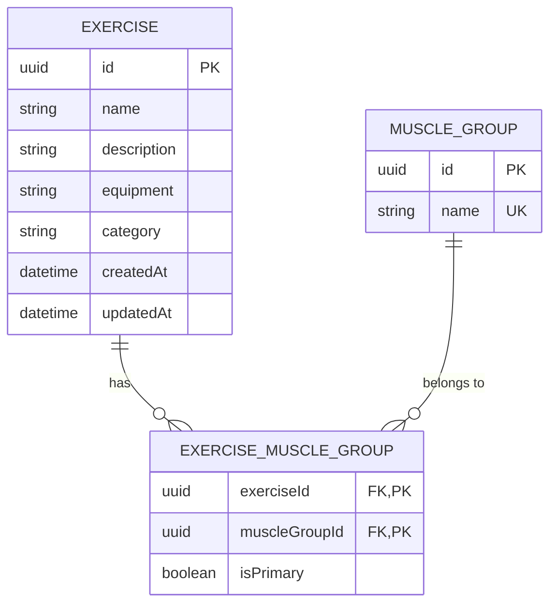

# 📚 DBMS & System Architecture Notes: Exercise Library & Session Tracker

> **Project:** Workout Tracker (Major Project)  
> **Contributor / Module Owner:** Arnav Maheshwari  
> **Subject Area:** Database Management Systems (DBMS), Relational Schema Design, RESTful APIs & Desktop Frontend Architecture  

---

## 1. Relational Database Schema & Many-to-Many Design

### 🎯 The Real-World Problem:
In a strength-training database, a single exercise (e.g. *Barbell Bench Press*) targets multiple muscles (*Chest*, *Triceps*, *Shoulders*). Conversely, a single muscle group (*Chest*) is engaged by dozens of exercises (*Bench Press*, *Incline Dumbbell Press*, *Push Ups*, *Cable Fly*).

This represents a classic **Many-to-Many ($M:N$) Relationship**.

### 📐 Relational Resolution via Junction Table:
In relational databases (3NF - Third Normal Form), an $M:N$ relationship cannot be represented cleanly in a single table without data redundancy or multi-valued attributes (which violates 1NF). We resolve it by decomposing into two $1:N$ relationships using an associative/junction table: `ExerciseMuscleGroup`.



---

## 2. PostgreSQL Raw DDL Equivalent

When Prisma executes migrations, here is the exact PostgreSQL Data Definition Language (DDL) executed under the hood:

```sql
-- 1. Exercise Catalog Table
CREATE TABLE "Exercise" (
    "id" UUID NOT NULL DEFAULT gen_random_uuid(),
    "name" VARCHAR(100) NOT NULL,
    "description" TEXT,
    "equipment" VARCHAR(50) NOT NULL,
    "category" VARCHAR(50) NOT NULL,
    "createdAt" TIMESTAMP(3) NOT NULL DEFAULT CURRENT_TIMESTAMP,
    "updatedAt" TIMESTAMP(3) NOT NULL,

    CONSTRAINT "PK_Exercise" PRIMARY KEY ("id")
);

-- 2. Muscle Group Lookup Table
CREATE TABLE "MuscleGroup" (
    "id" UUID NOT NULL DEFAULT gen_random_uuid(),
    "name" VARCHAR(50) NOT NULL,

    CONSTRAINT "PK_MuscleGroup" PRIMARY KEY ("id"),
    CONSTRAINT "UQ_MuscleGroup_Name" UNIQUE ("name")
);

-- 3. Junction Table (Associative Entity)
CREATE TABLE "ExerciseMuscleGroup" (
    "exerciseId" UUID NOT NULL,
    "muscleGroupId" UUID NOT NULL,
    "isPrimary" BOOLEAN NOT NULL DEFAULT false,

    -- Composite Primary Key: Prevents duplicate mapping of the same exercise to the same muscle
    CONSTRAINT "PK_ExerciseMuscleGroup" PRIMARY KEY ("exerciseId", "muscleGroupId"),

    -- Foreign Key to Exercise (Cascade delete when parent exercise is removed)
    CONSTRAINT "FK_ExerciseMuscleGroup_Exercise" FOREIGN KEY ("exerciseId")
        REFERENCES "Exercise"("id") ON DELETE CASCADE ON UPDATE CASCADE,

    -- Foreign Key to MuscleGroup (Cascade delete when muscle is removed)
    CONSTRAINT "FK_ExerciseMuscleGroup_MuscleGroup" FOREIGN KEY ("muscleGroupId")
        REFERENCES "MuscleGroup"("id") ON DELETE CASCADE ON UPDATE CASCADE
);

-- 4. B-Tree Indexes for High Performance Queries
CREATE INDEX "Exercise_name_idx" ON "Exercise"("name");
CREATE INDEX "Exercise_category_idx" ON "Exercise"("category");
CREATE INDEX "Exercise_equipment_idx" ON "Exercise"("equipment");
CREATE INDEX "ExerciseMuscleGroup_muscleGroupId_idx" ON "ExerciseMuscleGroup"("muscleGroupId");
```

---

## 3. Raw SQL Queries (DML) for the API Endpoints

### Query 1: Filter Exercises by Target Muscle (Multi-Table `JOIN`)
When a user clicks the **"Chest"** filter chip in the frontend, this query executes:

```sql
SELECT 
    e.id, 
    e.name, 
    e.category, 
    e.equipment, 
    e.description,
    ARRAY_AGG(mg.name) AS "muscleGroups"
FROM "Exercise" e
JOIN "ExerciseMuscleGroup" emg ON e.id = emg."exerciseId"
JOIN "MuscleGroup" mg ON emg."muscleGroupId" = mg.id
WHERE e.id IN (
    SELECT sub_emg."exerciseId"
    FROM "ExerciseMuscleGroup" sub_emg
    JOIN "MuscleGroup" sub_mg ON sub_emg."muscleGroupId" = sub_mg.id
    WHERE LOWER(sub_mg.name) = LOWER('Chest')
)
GROUP BY e.id, e.name, e.category, e.equipment, e.description
ORDER BY e.name ASC;
```
> **Viva Explanation:** Subquery filters exercise IDs linked to 'Chest', and outer query aggregates all secondary muscle groups for the matched exercises using PostgreSQL's `ARRAY_AGG()`.

---

### Query 2: Search Exercises with Case-Insensitive Matching
When the user types `bench` into the search bar:

```sql
SELECT 
    e.id, 
    e.name, 
    e.category, 
    e.equipment
FROM "Exercise" e
WHERE e.name ILIKE '%bench%'
ORDER BY e.name ASC;
```
> **Viva Explanation:** Uses `ILIKE` (case-insensitive substring match) accelerated by the B-Tree index on `name`.

---

## 4. RESTful API Endpoints Specification

| Method | Endpoint | Description | Query Parameters |
|---|---|---|---|
| `GET` | `/api/exercises` | List exercises with optional filters | `?q=bench&muscle=Chest&equipment=Barbell&category=Compound` |
| `GET` | `/api/exercises/muscle-groups` | Retrieve distinct muscle groups | None |
| `GET` | `/api/exercises/:id` | Fetch detailed single exercise | Path param `:id` (UUID) |
| `GET` | `/api/health` | Diagnostic ping for database & API | None |

---

## 5. Frontend & System Engineering Highlights

1. **Dual-Layer Offline Fallback Architecture**:
   - If the PostgreSQL database or local backend server is offline during an evaluation/viva, both the backend (`exerciseController.js`) and frontend (`ExerciseLibrary.jsx`) seamlessly switch to the embedded seed catalog (`DEFAULT_CATALOG`).
   - The application **never crashes** or displays a blank screen during offline demos.

2. **Decoupled Interval Timers in React**:
   - The **Workout Stopwatch Timer** and **Rest Interval Countdown Timer** run independently in separate `useEffect` hooks with clean cleanup closures (`clearInterval`).
   - Prevents memory leaks and render-lock cascading in Electron.

3. **Client-Side JSON Backup Utility**:
   - Enables data portability by converting state into a standardized Data URI blob (`data:text/json;charset=utf-8,...`) and triggering a native download anchor.

---

## 6. Viva FAQ Quick Revision (Cheat Sheet)

* **Q: Why use a Composite Primary Key `(exerciseId, muscleGroupId)` in the junction table?**  
  *Answer:* Composite primary key guarantees database-level integrity: a specific muscle group cannot be accidentally inserted twice for the same exercise.

* **Q: Why use `ON DELETE CASCADE` on `ExerciseMuscleGroup`?**  
  *Answer:* If an exercise is deleted from the catalog, its junction entries become obsolete. `CASCADE` automatically cleans them up, preventing orphan records.

* **Q: Why choose UUID over Auto-Incrementing Integer IDs?**  
  *Answer:* UUIDs (128-bit) are universally unique and can be safely generated on the client or server without collision, enabling seamless offline-first synchronization.
